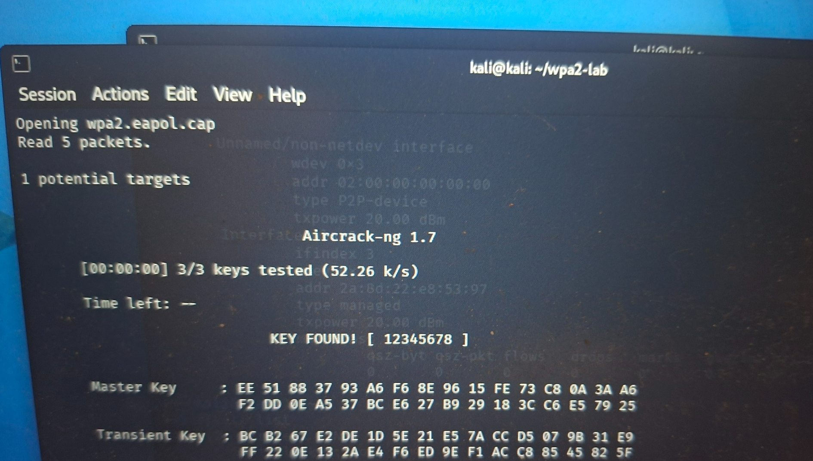

# Lab 02 — Offline WPA password verification

**Status: ✅ Verified success**  
**Environment:** Kali Linux 2026.3 VirtualBox guest, Aircrack-ng 1.7, NAT networking  
**Scope:** **Public Aircrack-ng sample data only.** No live Wi-Fi capture, radio injection, or household router testing.

## Objective
Understand how Crunch-style password candidates relate to an EAPOL handshake capture, and see Aircrack-ng accept the correctly matching candidate.

## Theory
The **four-way handshake** is part of WPA/WPA2 client authentication. In a suitable recorded exchange, testing software can derive candidate key material from a passphrase and network identifiers, then compare a computed integrity value to captured authentication data. A candidate either verifies or does not: there's no useful “almost matching MIC.”

These tools serve different purposes:
- **Crunch:** Generate candidate passwords based on character sets and templates.
- **airodump-ng:** Capture supported wireless frames from a compatible monitor-mode interface.
- **aircrack-ng:** Analyse suitable capture data and test candidate passphrases offline.

## Procedure reproduced in the Kali guest

```bash
mkdir -p ~/wpa2-lab && cd ~/wpa2-lab
curl -fL -o wpa2.eapol.cap \
  https://raw.githubusercontent.com/aircrack-ng/aircrack-ng/master/test/wpa2.eapol.cap
printf 'wrongpassword\nFrosty12\n12345678\n' > demo-wordlist.txt
aircrack-ng -a 2 -w demo-wordlist.txt wpa2.eapol.cap
```

| Command / argument | Purpose |
|---|---|
| `mkdir -p` | Create a dedicated lab directory without overwriting existing files. |
| `curl -fL -o` | Fetch the public sample, follow redirects, save it to a chosen file, and fail on HTTP errors. |
| `printf` | Create a 3-line fictional/testing candidate list. |
| `aircrack-ng -a 2` | Select WPA/WPA2-PSK testing mode. |
| `-w demo-wordlist.txt` | Read candidates from the specified list. |
| `wpa2.eapol.cap` | Input capture containing sample authentication information. |

## Verified output

```text
Aircrack-ng 1.7
Opening wpa2.eapol.cap
Read 5 packets.
1 potential targets
ESSID: Harkonen
WPA (1 handshake)
3/3 keys tested (52.26 k/s)
KEY FOUND! [ 12345678 ]
```

The result screenshot supplied by the learner on 2026-11-23 independently shows `3/3 keys tested` and `KEY FOUND! [ 12345678 ]`. It also shows an EAPOL HMAC and derived key fields. **That proves only a successful offline check against this public training capture.** It does not show gaining access to any Wi-Fi network.

## Screenshot evidence



The image records `KEY FOUND! [ 12345678 ]` with 3/3 candidates tested. The image will display after the prepared evidence file is uploaded to this folder.

## Defensive observations
- Long, unpredictable unique Wi-Fi passphrases resist small wordlist attacks better than common passwords.
- WPA3-SAE changes the offline guessing properties of personal Wi-Fi authentication.
- Merely seeing a handshake does not reveal a passphrase or grant access.

## Limitations and next practical
The sample was downloaded, not collected through a real adapter. This is a reproducible **offline cryptography and wordlist** exercise. A separate simulated Wi-Fi lab remains incomplete; do not combine their outcomes.
